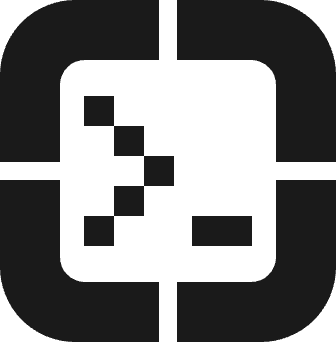
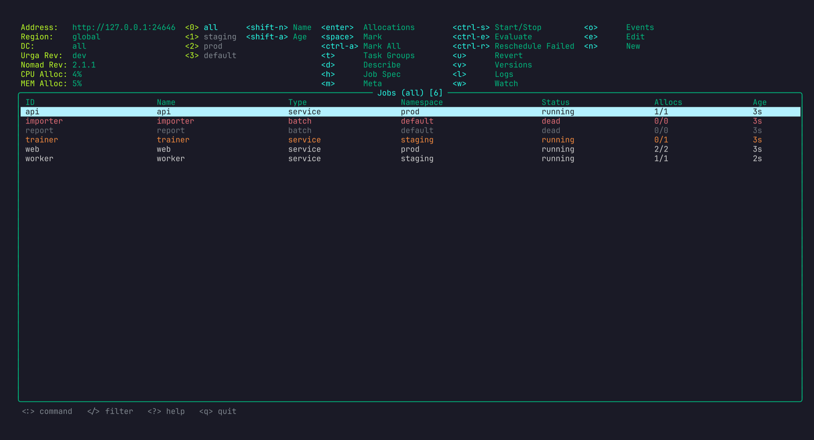
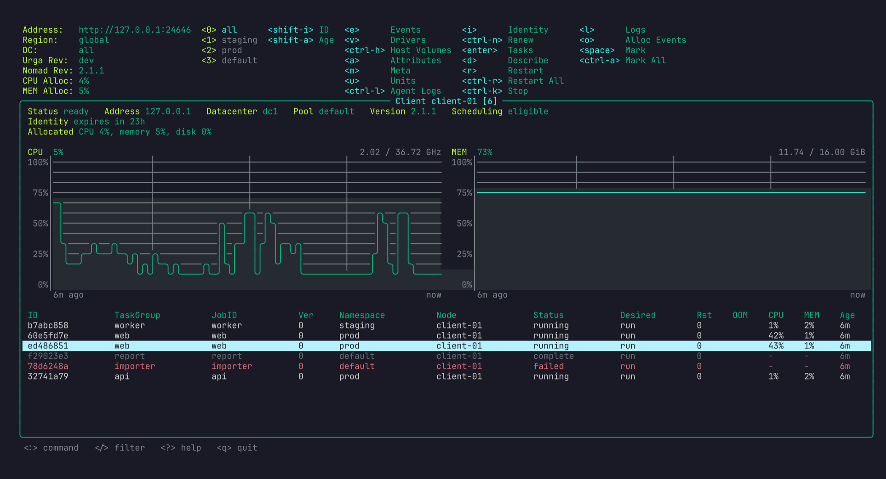

<div align="center">

<picture>
  <source media="(prefers-color-scheme: dark)" srcset="docs/images/logo-dark.png">
  
</picture>

# urga

[](https://github.com/ingvarch/urga/actions/workflows/ci.yml)
[](go.mod)
[](https://github.com/ingvarch/urga/releases/latest)
[](LICENSE)

</div>

urga is a terminal UI for HashiCorp Nomad, for anyone who runs work on a
Nomad cluster and wants to see it and act on it from the terminal. It is one
binary with no config to write and no browser: it reads the same environment
as the `nomad` CLI, lists every resource of the cluster, updates as the
cluster changes, and lets you inspect, start, stop and edit from the keyboard.
Igor Churmeev writes and maintains it as an independent project.





## Features

- Every resource of the cluster: jobs, allocations, tasks, deployments,
  evaluations, services, namespaces, variables, clients, node pools, servers,
  volumes, CSI plugins and ACL objects. Finds anything by its name or ID in
  every namespace.
- Live: screens update from the Nomad event stream, the status line says when
  an allocation or a deployment fails or a client goes down in any namespace,
  and one screen counts what needs attention.
- Jobs: edit in your editor and see the plan before anything is submitted,
  revert to any version, watch a deploy until it ends, see why a job is not
  placed, run periodic jobs now and dispatch parameterized ones.
- Logs and tasks: task logs and files followed as they grow, the log of a task
  from every allocation of a job at once, agent logs at any level, a shell in
  a task, restarts and signals.
- Clients and servers: drains and their progress, CPU and memory over time,
  what the allocations reserve, server health, garbage collection, and the
  scheduler configuration, edited with check-and-set.
- Variables, namespaces and ACL tokens, policies, roles, auth methods and
  binding rules: create, edit and delete them. Variables are written with
  check-and-set, and their values stay hidden until you ask.
- Read-only mode, several named clusters, and a note when a newer urga is
  out.

## Usage

```sh
brew install ingvarch/tap/urga
export NOMAD_ADDR=https://nomad.example.com:4646
export NOMAD_TOKEN=<your token>
urga
```

Packages for Debian, Fedora and Arch, archives for other systems and
`go install` are in [docs/install.md](docs/install.md). Press `?` for help,
`:` to open another screen, `/` to filter and `q` to quit.

## Quick start

You need Go, Nomad and golangci-lint, see
[docs/development.md](docs/development.md).

```sh
git clone https://github.com/ingvarch/urga.git
cd urga
make check
nomad agent -dev   # in another terminal
make run
```

## Documentation

- [Install](docs/install.md): Homebrew, deb and rpm packages, the AUR,
  release archives, Go and the source.
- [Configuration](docs/configuration.md): environment variables, flags,
  read-only mode, the token, newer releases, the editor, how screens stay up
  to date, and the saved session.
- [Named clusters](docs/clusters.md): an optional settings file for several
  clusters, and switching between them.
- [Keys and commands](docs/keys.md): the command line, the overview, find,
  events, sort, the filter, and the keys of every screen.
- [Jobs](docs/jobs.md): jobs, periodic and parameterized jobs, task groups
  and their scaling, editing and plans, versions, evaluations, deployments and
  watching a deploy.
- [Allocations and tasks](docs/allocations.md): allocations, every task of
  the namespace with `:tasks`, checks, task actions, logs and files.
- [Clients, servers and other resources](docs/clients.md): clients, servers,
  agent logs, the scheduler, namespaces, services, variables, node pools,
  regions and datacenters.
- [Storage](docs/storage.md): CSI volumes, dynamic host volumes and CSI
  plugins.
- [Access control](docs/acl.md): ACL tokens, policies, roles, auth methods
  and binding rules.
- [Development](docs/development.md): prerequisites, running against a local
  cluster, the checks and the project structure.

## License

MIT, see [LICENSE](LICENSE). The release archives and packages also carry
`THIRD_PARTY_NOTICES`, the licenses of the modules urga is built from.

Nomad is a trademark of HashiCorp. urga is an independent project and is not
affiliated with or endorsed by HashiCorp.

## Contributing

How to propose and send a change is in [CONTRIBUTING.md](CONTRIBUTING.md).
Security problems are reported privately, see [SECURITY.md](SECURITY.md).

## About the name

An urga is a Mongolian catch pole: a long wooden shaft with a loop of rope at
the end. A rider holds it out at a gallop and takes the one horse he wants out
of a herd of hundreds that is still moving.

A cluster is that herd. This is what you reach into it with.
